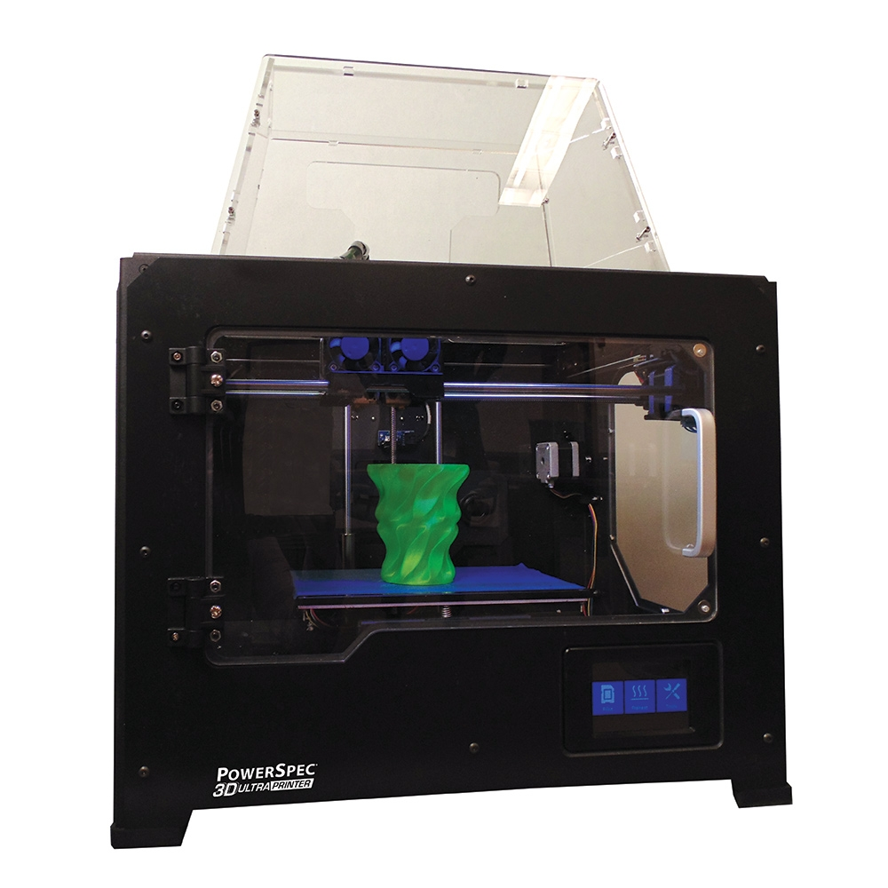

# PowerSpec Ultra PrusaSlicer Profile

PrusaSlicer profiles and Python helpers for a PowerSpec Ultra printer. The
startup sequence is based on previously successful PowerPrint G-code output.



*Stock product photo: [Micro Center](https://90a1c75758623581b3f8-5c119c3de181c9857fcb2784776b17ef.ssl.cf2.rackcdn.com/448607_705640_01_front_zoom.jpg).*

The important compatibility detail is the startup temperature sequence. The working files use:

```gcode
M140 S55
M104 S205 T1
G90
G28
M132 X Y Z A B
G1 Z100 F3300
G1 X-110.5 Y-74 F6000
M7
M6 T1
...
M108 T1
```

On the tested printer, PowerPrint's left physical extruder is `T1` and the
right physical extruder is `T0`. `M6 T1` is the wait/select-tool step the
left-extruder files expect. Generic RepRap `M109`/`M190` waits are avoided.

## Setup

Install PrusaSlicer and Python 3, then clone this repository:

```sh
git clone https://github.com/Mathew-Hart/prusa_powerspec_ultra.git
cd prusa_powerspec_ultra
```

Run the following commands from the repository directory.

## Slice From Command Line

PLA:

```sh
prusa-slicer --load powerspec_ultra_left_extruder.ini \
  --export-gcode --output /tmp/test_cube_20mm.g \
  test_cube_20mm.stl
python3 powerspec_ultra_postprocess.py /tmp/test_cube_20mm.g
```

ABS:

```sh
prusa-slicer --load powerspec_ultra_left_extruder.ini \
  --load powerspec_ultra_abs_left_extruder.ini \
  --export-gcode --output /tmp/test_cube_20mm_abs.g \
  test_cube_20mm.stl
python3 powerspec_ultra_postprocess.py /tmp/test_cube_20mm_abs.g
```

## Compare Output

Replace `{insert path here}` with the directory containing your reference
G-code, named `known_good.g` in this example:

```sh
python3 compare_gcode.py \
  "{insert path here}/known_good.g" \
  /tmp/test_cube_20mm.g
```

## GUI Import

In PrusaSlicer, use `File -> Import -> Import Config...` and select:

`powerspec_ultra_left_extruder.ini`

For ABS, import the base profile first, then import:

`powerspec_ultra_abs_left_extruder.ini`

Save the generated file with a `.g` extension for the printer SD card.

## Network Helper

`powerprint_net.py` requires an explicit printer address. Replace `PRINTER_HOST`
with your printer's IP address or hostname:

```sh
python3 powerprint_net.py --host PRINTER_HOST status
python3 powerprint_net.py --help
```

The default TCP port is 8899; use `--port` to override it.
